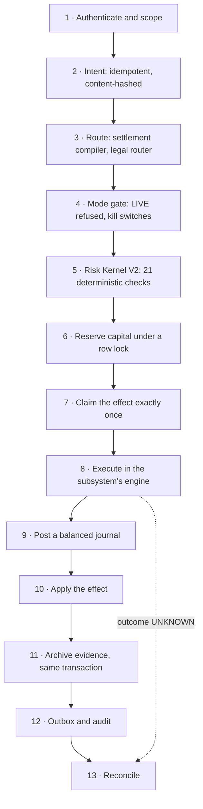
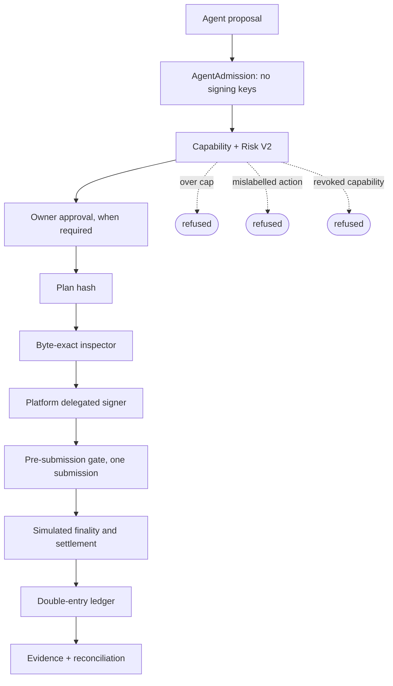

# Nodal

**Agents propose; deterministic systems authorize.**

Nodal is a sandboxed financial control plane for software agents. An agent, a person or a strategy can ask for
an economic action; the request becomes a typed, content-hashed intent, and deterministic code owns everything
after that: whether the action is allowed, whether capital is there for it, how it executes exactly once, how
it is booked in a double-entry ledger, what evidence it leaves and how it is reconciled. PostgreSQL 16 is the
financial source of truth, and it refuses states the application should never produce even when the
application code is wrong.

> **Simulated value only.** Nodal does not move real customer funds, provide live brokerage execution, or give
> agents signing authority. Every advanced capability moves value in the `SIMULATED` domain, the database
> refuses to let that value touch real capital, and `LIVE` is not a representable mode for any of them.

## Why Nodal exists

Letting a model suggest a trade is easy. Letting it near money without giving a probabilistic system authority
is not. Retries can apply the same value twice, concurrent requests can oversubscribe capital, a timeout can
leave an outcome unknown, and one accounting bug corrupts every subsystem built on top of the ledger.

Nodal treats those as structural problems rather than conventions. Models and agents only produce requests,
and a request is untrusted input. Authorization, risk, capital reservation, execution, accounting and recovery
are deterministic code, and the invariants that matter most are enforced again inside PostgreSQL, where a bug
in Go cannot talk its way past them.

The interesting part is not the number of financial products. It is that a margin liquidation, an option
expiry, a prediction-market payout and an agent's delegated swap all pass through the same control boundary
and the same accounting kernel.

## Verify it

Prerequisites: Go 1.27 (`GOTOOLCHAIN=local`, with `go` on `PATH`: the sandbox tests compile strategies to
WASM), PostgreSQL 16 on `127.0.0.1:5433` with the roles in `docker/postgres/init/001_roles.sql`
(`docker compose up -d --wait postgres`), and `make`.

```sh
go run ./scripts/testcensus              # declared tests by kind and package (counts; runs nothing)
go run ./scripts/testcensus -advanced    # the same for the 28 advanced-capability packages
make advanced-demo                       # 10 end-to-end scenarios on a fresh local database -> dist/advanced-demo.json
go test -count=1 ./test/security/...     # authority-boundary and import guards
go test -count=1 ./test/docs/            # every test the evidence document cites still exists
```

Every claim in [`docs/portfolio/TECHNICAL_EVIDENCE.md`](docs/portfolio/TECHNICAL_EVIDENCE.md) names the code
behind it, the exact test functions that prove it, its caveat, and one command that runs exactly those tests
(database-backed tests run through `scripts/inttest`, which gives each package a fresh, fully migrated
database). The restore drill also needs the PostgreSQL 16 client tools: `make restore-drill` on a host with
Docker, or `go run ./scripts/restoredrill -pg-bin "$PG_BIN"`; see
[`docs/operations/BACKUP_RESTORE.md`](docs/operations/BACKUP_RESTORE.md). `make help` lists every target.

## Evidence at a glance

| Evidence | Figure | Status |
|---|---|---|
| Go tests | 4,244 across 133 packages: 2,782 unit, 203 property, 79 fuzz, 1,180 integration | current, `scripts/testcensus` |
| Advanced-capability tests | 1,443 across 28 packages: 696 unit, 130 property, 35 fuzz, 582 integration | current, `scripts/testcensus -advanced` |
| Web tests | 277 unit; 162 Playwright tests, 240 cases once parametrized: 238 passed, 2 skipped, 0 failed, twice on fresh seeded databases | census current; browser run recorded at `7c493fa` |
| End-to-end scenarios | 10 scenarios, 116 / 116 exact checks | demo run, Oct 8 2026 (`dist/advanced-demo.json`) |
| Database refusals | 135 custom SQLSTATE refusal codes in the 30 advanced migrations (`00730`-`00764`) | current |
| API | 316 operations (249 advanced), every one with an explicit authorization policy | current, `TestEveryGeneratedOperationHasAnExplicitPolicy` |
| Restore drill | 269 tables restored with identical row counts, zero balance drift, equal journal hashes; 145 seeded advanced rows across 12 areas | drill run, Oct 8 2026, schema 764 (`dist/restore-drill.json`) |
| Adversarial review | 3 passes, 32 findings including 7 High, all fixed with a regression test | [`docs/reviews/`](docs/reviews/) |
| Executable claims | 67 documented technical claims, each mapped to the command that checks it | [`TECHNICAL_EVIDENCE.md`](docs/portfolio/TECHNICAL_EVIDENCE.md) |

`dist/` is not tracked; `make advanced-demo` and the restore drill regenerate those reports. There is no
performance benchmark of record (see [Limitations](#limitations)).

## What is implemented

Everything below is merged on `main`. Paper means simulated fills against a reference mark or an internal
book; Sandbox means a complete workflow against a deterministic provider inside the repository; Simulated chain
means the in-process chains in `internal/sandboxchain` and `internal/devnethost`, which use real Ed25519
signatures and are not public testnets.

| Capability | What exists | Mode / boundary |
|---|---|---|
| Stable asset | Fully reserved issuance and redemption, a supply cap, Ed25519-signed hash-linked reserve snapshots, a peg circuit breaker; supply reconciled against the chain and every holding | Sandbox, simulated chain; not a launched stablecoin |
| Margin and leverage | Cross and isolated accounts, initial and maintenance margin, haircuts, lending-pool loans, exactly-once daily interest, margin calls, deterministic reduce-only liquidation, insurance fund, deficits | Paper, sandbox |
| Futures, perpetuals, options | Exact cash flows and funding, expiry priced by a documented rule, bounded two-operator overrides, terms frozen while positions are open; option prices and reference Greeks in exact fixed point | Paper, sandbox; Greeks are never posted |
| Equities | Listings on an XNYS calendar (sessions, holidays, halts), a paper venue, T+1 settlement, splits, dividends, symbol changes, delistings, fractional shares | Paper |
| Internal order books | Deterministic price-time-priority matching with self-trade prevention, a persistent hash-chained journal, replay from empty or a snapshot | Paper |
| Customer transfers | Sender-scoped idempotency, content-hashed requests, row-locked reservations, two-operator reversals | Sandbox dollar only |
| Principal inventory | Segregated house books with loss, inventory and exposure limits, a disclosed crossing rule, operator plus step-up, kill switch | Paper, sandbox |
| Fees | Versioned, immutable, hashed schedules; stored disclosures that re-verify; component-by-component booking | Paper, sandbox |
| Performance fees | High-water mark across periods; deposits are not performance; withdrawals do not erase accrued performance | Paper, sandbox |
| Strategy marketplace | Go source, scanned, built under bounds, approved by a second person, installed and followed in paper; results recomputed from fills and marks | Paper |
| WASM strategy execution | Restricted Go compiled to WASM and run in wazero under WASI preview1 with no filesystem, environment, sockets or real clock | Sandbox; not a microVM |
| Delegated agent capabilities | Hashed, frozen capabilities; plan-hash approvals; a byte-exact transaction inspector; one platform signature under concurrency | Simulated chain; agents hold no keys |
| Withdrawals | Approved destinations, cooling period, per-withdrawal, daily and velocity limits; plan hash covers amount and destination | Simulated chain only |
| Bridge | Lock-and-release between two simulated chains, attested releases, refunds and reorg handling; value in flight counts toward buying power only at a policy haircut | Two in-process simulated chains |
| Prediction markets | Complete sets issued against escrow, internal share trading, signed oracle reports, disputes, resolver separation, two-operator voids | Paper, sandbox |

## One economic operation

Every mutating operation of every advanced subsystem has the same shape
([`ADVANCED_FINANCIAL_MODEL.md` §6](docs/architecture/ADVANCED_FINANCIAL_MODEL.md)). It runs inside one
database transaction, except when a step is external, such as a submission to a simulated chain. That step
sits between two transactions, and its outcome can be `UNKNOWN`.



The effect claim in step 7 is what makes retries safe. An effect key is unique, a different request under the
same key is refused (`INVALID_IDEMPOTENCY_REUSE`), and a replay returns the first outcome: `APPLIED` means
done, `UNKNOWN` means *do not retry*. An unknown outcome goes to reconciliation, which observes what actually
happened instead of resubmitting. Risk Kernel V2 hashes its decisions and gives byte-identical answers for
identical inputs. Stale or missing inputs block anything that increases risk and never block risk reduction.

## The invariants live in PostgreSQL

The Go services enforce these rules first. The database enforces them again, so a bug, or code that bypasses
a service, still cannot commit the state. A few of the refusals:

- **Simulated value cannot touch real capital.** `SIMULATED` never moves to or from another value domain
  (`VD002`), and an advanced journal kind can only touch simulated accounts (`SM001`).
- **Journals balance per party.** Every journal balances per asset at COMMIT, and a simulated journal balances
  for each owner, so value moves between parties only as explicit pairs (`SM002`).
- **An applied effect has a journal.** A ledger-posting effect cannot be `APPLIED` without its journal, and a
  journal can back only one effect. The effect status machine itself is SQL (`EF001`), and a guarded state
  change needs a transition row naming both endpoints (`AU001`).
- **An unbooked fee is refused.** A trade, fill or liquidation step that charges a fee the fee ledger did not
  book fails at COMMIT (`FW001`).
- **Stable-asset holdings equal issuer supply.** Any transaction touching a platform stable asset or a bridged
  twin changes its holdings by exactly what it changes the issuer's outstanding supply (`SU002`). No trade,
  grant or paper fill can create or destroy a unit.
- **A delegated action matches its direction of value.** A swap's stored label must agree with the assets
  it actually moves, at admission and again at signing (`DG007`). A purchase cannot pass as a reduction.

Advanced migrations currently define 135 distinct custom SQLSTATE refusal codes. A migration test checks that
every code a migration documents can actually be raised. The refusals bind the application role (`cp_app`).
The table owner can still disable a trigger, and catching that is the job of detection (balance
recomputation and signed Merkle checkpoints of the audit history), not prevention.

## Agents propose, they do not own authority

Agents are untrusted proposal generators. Here is the delegated-swap path, which is demo Scenario F:



- **The agent holds no key.** The admission facade's whole surface is two admissions and a capability read.
  It is built with no seed, key or signer, has no field that could hold one, and the agent worker never reads
  the sandbox seed.
- **The agent cannot sign, approve or withdraw.** Under the agent's principal, approving and executing a swap
  are both refused. The settlement compiler refuses an agent's transfer or withdrawal at every authority
  level, even in simulation. An agent can only *propose* a withdrawal, and a person decides it.
- **Agents never reach the HTTP API.** Every generated HTTP operation refuses an agent principal. The agent
  packages import no signing, wallet, admin, gate, withdrawal or kill-switch package, and a security test
  enforces that.
- **Authority comes from what a request does, not what it says.** Capabilities are hashed over every term
  and frozen. An approval binds the plan hash. The inspector accepts only the exact planned bytes. Ten
  executors racing on one swap produce exactly one signature.
- **Model output is untrusted input.** The deployed agent worker currently has *no* model evaluator wired in.
  It is built with an evaluator that refuses every run with `MODEL_UNAVAILABLE`. The demo and the tests inject
  a deterministic evaluator through the runtime's own injection point.

## Architecture

Nodal is a Go 1.27 modular monolith, not a microservice fleet: one module, 171 packages (124 under
`internal/`), and ten binaries split along trust boundaries (`api`, `advanced-worker`, `agent-worker`,
`audit-worker`, `execution-worker`, `market-ingest-worker`, `migrate`, `reconciliation-worker`,
`relay-worker`, `workflow-worker`).

- **PostgreSQL 16** holds every balance, journal, intent, effect and piece of evidence. It also coordinates
  the system through row locks, deferred constraint triggers and work queues, across 91 migrations.
- **Pure deterministic cores** need no I/O: matching (`internal/matching`), fixed-point option analytics
  (`internal/quant`), spread, fee and performance-fee engines (`internal/fees`), Risk Kernel V2
  (`internal/risk`), margin planning and the simulated chain model (`internal/devnet`).
- **The API contract** is [`openapi/openapi.yaml`](openapi/openapi.yaml), from which both the Go server and the
  TypeScript client are generated.
- **The web app** (`apps/web`) is React 19, Vite and TypeScript.
- **The outbox** is written in the same transaction as the change it records. `relay-worker` relays it to
  Redpanda.
- **Strategy code** runs in [wazero](https://wazero.io) under WASI preview1.
- **The V1 layer** keeps Temporal (`workflow-worker`), ClickHouse for analytics and MinIO/S3 for evidence.
  No evidence claim in this repository depends on Redis, Redpanda, ClickHouse, Temporal or MinIO.

## Financial subsystems

- **Ledger and capital.** An append-only, double-entry, multi-asset ledger. Postings are idempotent on their
  key, and history is never edited: corrections are compensating transactions. Reservations cannot
  oversubscribe under concurrency.
- **Margin and liquidation.** Liquidation plans are deterministic (the same input gives the same plan hash)
  and reduce-only, with bounded slippage. A stale price makes liquidation wait rather than guess, and a kill
  switch never stops it. The insurance fund covers a deficit exactly once. A case in manual review leaves it
  only on one operator's proposal and a different operator's approval.
- **Derivatives.** Futures and perpetual cash flows conserve value. Expiry prices come from a documented rule
  over marks recorded in order and on time, never from the caller. Option analytics run in exact fixed point
  and are checked against an independent 320-bit `big.Float` oracle.
- **Matching and equities.** A 120,000-command stream replays to the same state hash. The persistent book's
  journal proof recomputes every trade, its fees and its journal. Paper equity orders respect sessions and
  halts, and sale proceeds stay unwithdrawable until T+1.
- **Stable asset and bridge.** The issuer signs only the planned mint. Reserve snapshots are signed and
  hash-linked. The bridge keeps locked equal to outstanding plus in flight, and a finalized transaction never
  reverts.
- **Marketplace and sandbox.** Strategy output can only become a risk-checked paper intent of a kind its
  manifest allows, never a transfer, a withdrawal or a signing call.
- **Prediction markets.** Payouts equal escrow exactly over random sequences of trading. Nobody rules on
  their own question, and a void needs two distinct operators.

## Testing and adversarial review

- **Unit and property tests:** `rapid` properties state conservation, per-party balance, idempotency and
  no-overfill across the ledger, capital, transfers, margin, derivatives, order books, prediction markets and
  fees.
- **Fuzz targets:** decimal and key parsers, the transaction inspector, the order book, disclosure
  verification and the option analytics.
- **Integration tests:** each package runs against a fresh, fully migrated PostgreSQL 16 database. The 1,180
  integration tests include the chaos- and e2e-tagged ones.
- **Browser tests:** the Playwright suite runs against a production build served by `vite preview`, with a live
  API over real PostgreSQL.
- **Security tests:** import-boundary rules, deny-by-default authorization, tenant isolation and
  agent-escalation probes.
- **Migration tests:** checksums, role privileges, state-change binding, and raising every documented SQLSTATE.
- **Executable claims:** the 67 claims in `TECHNICAL_EVIDENCE.md` are kept honest by `test/docs`, which fails
  if a cited test function stops existing.

The advanced subsystems went through three adversarial review passes, recorded in two documents. The reviewers
were separate, read-only AI reviewer sessions that had not written the code under review. These are internal
reviews, not an external audit. Every confirmed finding came with a reproduction compiled into the package
through `go test -overlay`, and a finding counts as fixed only when its reproduction fails and a regression
test pins the property.

- [`ADVANCED_SYSTEMS_REVIEW.md`](docs/reviews/ADVANCED_SYSTEMS_REVIEW.md) covers two passes and 27 findings: 7
  High, 12 Medium and 8 Low.
- [`SECURITY_RED_TEAM.md`](docs/reviews/SECURITY_RED_TEAM.md) adds five findings, one Medium and four Low.
- All 32 findings are fixed.
- The red team also recorded four observations. Three are fixed. The fourth, that fee reversals and
  corporate actions are single-operator actions on simulated value, is recorded as a sandbox residual.

## The hardest bug

The hardest bug was a stable-asset invariant that was right in application logic but incomplete at the
database boundary.

1. **A legitimate operation tripped the breaker.** A legitimate bridge in demo Scenario G tripped the
   stable-asset circuit breaker. Supply reconciliation counted customer wallets as "outstanding", but value
   can legitimately sit in collateral, escrow, a bridge lock or house inventory.
2. **Holdings were redesigned.** Every code in the chart of accounts is now classified as holding value or
   not. The Go list (`ledger.HoldingCodes`) has a SQL twin, with parity tests between them.
3. **The database learned the identity.** The third review then showed that holdings were still not tied to
   issuer supply inside the database. Migration `00763` added the transaction-level identity: holdings change
   exactly with issuer outstanding.
4. **A correct refusal could wedge a liquidation.** On some paths, the new database refusal was now the
   *only* refusal. A margin account using the stable asset as its numeraire could reach a liquidation that
   could never commit.

The final design refuses an impossible configuration up front, at fourteen application entry points, before
anything is written. A table with one row per journal kind names each kind's guard and is checked against the
database rule. A refusal is not enough on its own: every invariant also needs a path that keeps the state
machine from getting stuck.

## Development note

I designed Nodal's architecture, invariants, interfaces, threat model and acceptance criteria, and used coding
agents heavily for implementation and adversarial review. Commit trailers preserve that provenance.

## Limitations

- **Simulated only.** Every advanced capability is simulated. `LIVE` is refused in code and cannot be written
  as an intent's mode, so enabling one would take a code change, a migration and a gate ceremony.
- **No real money.** No live brokerage, custody, customer onboarding or real funds. Nothing has been broadcast
  to a public blockchain.
- **No model in the agent worker.** The deployed agent worker has no model evaluator wired in, and nothing
  here measures the quality of any model's proposals.
- **The chains are not public testnets.** The simulated chains are in-process models. Signers are in-process
  too, with the seed held in a closure: there is no HSM, and the KMS signer has run only against a fake
  client.
- **No performance benchmark of record.** `make perf-advanced` exists, but no figures from an idle machine
  have been recorded, and the local cluster runs with `fsync=off`.
- **The WASM sandbox is not a microVM.** It is a restricted Go-to-WASM pipeline with bounded builds; the Go
  compiler itself runs on the host.
- **External providers are untested live.** Stripe, Privy, Helius and Jupiter adapters are contract-tested
  against recorded fixtures only.
- **V1 Solana execution does not run end to end.** The execution worker refuses to start in every provider
  mode because no venue adapter is wired.
- **No whole-suite runs.** No single run of the whole integration suite at one commit has been recorded, nor
  `-race` across every advanced package, nor a bounded fuzzing campaign. Each claim's own tests were run.
- **The restore drill is partial.** It seeds 12 of the 20 advanced areas. The production restore procedure is
  documented but has never been exercised, and Terraform validates but has never been applied.
- **Three baseline findings are open.** The internal audit register
  ([`docs/audit/AUDIT_FINDINGS.md`](docs/audit/AUDIT_FINDINGS.md)) lists F-31, F-42 and F-47 as open.
- **No outside review or licence.** No external audit, certification or regulatory licence covers anything
  here.

## Repository map

```
cmd/            the ten binaries
internal/       124 packages: econ (intents, effects, evidence), ledger, capital, risk, settlement,
                delegation, margin, derivatives, orders, matching, equities, transfers, treasury,
                fees, feeledger, stableasset, bridge, predmarket, marketplace, sandboxrt, ...
migrations/     91 migrations; the advanced range is 00730-00764
openapi/        the API contract
apps/web/       the web application
scripts/        testcensus, inttest, advanceddemo, restoredrill, testdb, ...
test/           security, migrations, docs, e2e, contract fixtures
docs/           architecture, ADRs, reviews, evidence, operations, threat model
```

Start with these:

- [`docs/architecture/ADVANCED_FINANCIAL_MODEL.md`](docs/architecture/ADVANCED_FINANCIAL_MODEL.md): the
  contract every advanced subsystem follows, including posting rules, the 13-step operation and exactly-once
  effects.
- [`docs/portfolio/TECHNICAL_EVIDENCE.md`](docs/portfolio/TECHNICAL_EVIDENCE.md): every defensible claim, with
  its tests, caveat and command, and the claims not to make.
- [`docs/reviews/ADVANCED_SYSTEMS_REVIEW.md`](docs/reviews/ADVANCED_SYSTEMS_REVIEW.md) and
  [`docs/reviews/SECURITY_RED_TEAM.md`](docs/reviews/SECURITY_RED_TEAM.md): the review registers.
- [`docs/architecture/AGENT_RUNTIME.md`](docs/architecture/AGENT_RUNTIME.md) and
  [`docs/adr/0012-no-ai-signing.md`](docs/adr/0012-no-ai-signing.md): the agent boundary.
- [`docs/adr/0020-advanced-financial-capabilities-sandbox-first.md`](docs/adr/0020-advanced-financial-capabilities-sandbox-first.md):
  why everything advanced is sandbox-first.
- [`docs/build/ADVANCED_TEST_EVIDENCE.md`](docs/build/ADVANCED_TEST_EVIDENCE.md) and
  [`docs/operations/BACKUP_RESTORE.md`](docs/operations/BACKUP_RESTORE.md): recorded runs and the restore drill.
- [`docs/PRODUCTION_READINESS_REPORT.md`](docs/PRODUCTION_READINESS_REPORT.md): why the platform is NOT_READY.

Local configuration starts from `.env.example`, and the credentials in `docker-compose.yml` are for local use
only.
